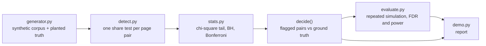

# cannibal

Search cannibalisation detection with multiple-testing correction, so the list is twelve real pairs instead of 180 noisy ones.

[](https://github.com/SlateGitOrg/cannibal/actions/workflows/ci.yml)

## Why

When several pages on a site compete for the same search query, each ranks worse than one consolidated page would, and the content team keeps writing more pages on the topic because it "underperforms". The usual tools sort page pairs by overlap and hand over the top of the list. On a catalogue-sized site that means thousands of comparisons, so noise always ends up at the top. `cannibal` tests every within-query page pair for genuine competition, corrects for the number of tests, and reports a short list you can act on.

## Features

- Seeded synthetic generator that produces Search-Console-shaped data (daily clicks per page per query, shared seasonality and trend) with planted cannibalising pairs and independent null pairs, so precision is measured instead of asserted.
- One hypothesis test per within-query page pair: a chi-square homogeneity test on page A's share of the pair's daily clicks.
- Multiple-testing procedures written from scratch: no correction, Benjamini-Hochberg (FDR) and Bonferroni (FWER).
- A baseline "raw overlap ranking" and a naive "raw click correlation" statistic, kept in the code so the comparison in this README is reproducible.
- Repeated-simulation evaluation reporting mean FDR, power and false pairs per site, with standard errors.
- Pure standard-library Python: a hand-written incomplete-gamma chi-square tail, no dependencies.

## Architecture



`generator.py` builds a corpus where every query rides one site-wide demand curve and a known set of pairs genuinely cannibalise. `detect.py` runs one test per pair and `stats.py` supplies the p-value tail and the correction procedures. `decide()` scores a procedure against the planted truth, `evaluate.py` repeats that over many simulated sites, and `demo.py` prints the report.

## Quick start

Prerequisites: Python 3.12+ (3.11 works but is slower and produces different seeded numbers). Nothing to install.

```bash
git clone https://github.com/SlateGitOrg/cannibal.git
cd cannibal
python -m src.demo                        # the full report, about 4 s on 3.12
python -m unittest discover -s tests -v   # the test suite
```

## Usage

`python -m src.demo` runs one catalogue-scale site, a confounder comparison, and two repeated simulations. Trimmed output:

```text
ONE SITE: 1112 queries, 60 days, 3575 page pairs tested
Planted cannibalising pairs (ground truth): 12

procedure       flagged     real    false    false %    found
uncorrected         173       12      161      93.1%      12/12
bh                   14       12        2      14.3%      12/12
bonferroni           12       12        0       0.0%      12/12

Raw overlap ranking (sort pairs by shared click volume), top 12: 1 real, 11 false.
...
HEADLINE
Uncorrected: 65.0% of the reported pairs are false (23.1 false pairs per site).
BH at alpha=0.05: FDR 0.0417 (se 0.0067), power 1.0000 -- a short list you can act on.
Where the effect is weak, BH power 0.285 beats Bonferroni power 0.218
```

## How it works

**The test.** For a pair of pages ranking for the same query, the statistic tests whether page A's share of the pair's daily clicks is constant over the window. With two days this is exactly the two-proportion z-test (a unit test checks the equivalence). Conditioning on each day's pair total cancels shared seasonality and trend, which is what makes it valid on real-shaped traffic.

**The correction.** Thousands of pairs means thousands of tests. At alpha = 0.05 an uncorrected run flags about 5% of the null pairs. Benjamini-Hochberg controls the false discovery rate and keeps more power than Bonferroni when the effect is modest.

**Why not correlate raw clicks.** Every page rides the same demand curve, so raw click series co-move whether or not the pages compete. No correction can rescue a confounded statistic.

### Measured results

All numbers come from `python -m src.demo` on Python 3.12 (seeded, reproducible).

One catalogue-scale site (1,112 queries, 60 days, 3,575 page pairs, 12 planted pairs, alpha = 0.05):

| Procedure | Flagged | Real | False | Planted found |
|---|---|---|---|---|
| No correction | 173 | 12 | 161 | 12/12 |
| Benjamini-Hochberg | 14 | 12 | 2 | 12/12 |
| Bonferroni | 12 | 12 | 0 | 12/12 |
| Raw overlap ranking (top 12 by shared volume) | 12 | 1 | 11 | 1/12 |

Repeated simulation (80 sites, about 514 tests each, strong planted effect):

| Procedure | Mean FDR (se) | Mean power | False pairs per site |
|---|---|---|---|
| No correction | 0.650 (0.007) | 1.000 | 23.15 |
| BH | 0.042 (0.007) | 1.000 | 0.57 |
| Bonferroni | 0.001 (0.001) | 1.000 | 0.01 |

Weak planted effect (60 sites, displacement 0.03): BH power 0.285 against Bonferroni 0.218. BH FDR is 0.059 (se 0.015) and uncorrected FDR is 0.755.

Confounded statistic with the same BH step (10 sites): raw click correlation flags 198 of about 200 pairs with FDR 1.000. The share statistic flags 12.3 with FDR 0.023.

More detail on design decisions and failure modes is in [docs/ARCHITECTURE.md](docs/ARCHITECTURE.md).

## Testing

```bash
python -m unittest discover -s tests -v
```

35 tests cover the numerical core against known values (chi-square and normal tails, BH and Bonferroni), the generator (determinism, planted truth, calibrated null, seasonal confound), and the detection pipeline. The detection tests assert that planted pairs are found, that BH keeps the false discovery rate from being significantly above alpha over 150 simulated sites, that BH is strictly more powerful than Bonferroni near the detection floor, and that BH on a confounded statistic flags nearly everything.

## Project layout

```text
src/
  generator.py   synthetic corpus with planted cannibalisation
  detect.py      share homogeneity test, raw correlation baseline, decide()
  stats.py       chi-square / normal tails, BH, Bonferroni
  evaluate.py    repeated-simulation FDR and power
  demo.py        the report
tests/           unit and statistical tests
docs/            architecture notes
```

## Limitations

- All numbers come from synthetic data. The planted effect is a day-to-day swing in share within a pair, and real Search Console cannibalisation may not look like that.
- BH controls FDR at alpha times m0/m, with near equality, so measured FDR sits close to 0.05 and can land slightly above it on a finite run. The tests assert it is not significantly above alpha (mean - 3 se < alpha).
- Ranking by overlap volume is not at chance here: planted queries have two pages, so volume leaks a little signal (precision about 0.12 in the tests against about 0.04 at chance). It is still far below BH's precision.
- Sampling uses `random.binomialvariate` (Python 3.12+). On 3.11 an exact fallback works but is much slower, and seeded numbers differ between versions.
- Not included: live Search Console ingestion, an effect-size floor, consolidation recommendations, before/after tracking and a UI. The tool uses daily click splits in place of impressions. It is meant to run on data you own, through the official API.

## License

MIT — see [LICENSE](LICENSE).
