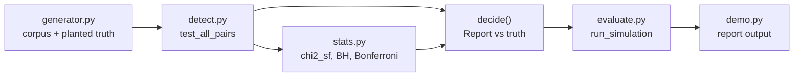

# Architecture

## Context

Pages on the same site that target the same query split its clicks and rank worse than a single consolidated page. Spotting them means testing every within-query page pair, which on a catalogue-sized site is thousands of comparisons. `cannibal` is a reference implementation of doing that testing correctly and of measuring how well it works.

## Container view

- `generator.py`: per query, daily demand is seasonality x trend x multiplicative noise, split across pages by a Dirichlet-like draw. A small known set of queries has exactly two pages whose split flips by a daily coin flip while the pair total is untouched (the planted cannibalisation), so the signal is invisible to volume or overlap statistics. Sampling is exact binomial/multinomial from the standard library.
- `detect.py`: `share_homogeneity_test` (shipped statistic), `raw_correlation_test` (baseline), `test_all_pairs` (one test per pair) and `decide` (apply a procedure, score against truth).
- `stats.py`: regularised incomplete gamma by series and continued fraction, the chi-square and normal upper tails, and the BH and Bonferroni procedures.
- `evaluate.py`: runs many independent sites and reports mean FDR, power and false pairs with standard errors.
- `demo.py`: prints the single-site comparison, the confounder comparison and the simulation tables.

## Key decisions

**Test the pair's share, not the raw series.** Conditioning on the pair's daily click total cancels the shared demand curve. Raw correlation of two click series is large for almost every pair on a seasonal site, so even with BH it flags nearly everything (FDR 1.000 in the demo). Cost: the statistic only sees pages that rank for the same query on the same days.

**Benjamini-Hochberg as the default correction.** It controls the false discovery rate, which matches the question "of the pairs I act on, how many are wrong". Bonferroni controls the stricter family-wise error and loses power when effects are modest (0.218 against 0.285 in the weak-effect run). Both are reported side by side.

**Plant benign pairs as well as real ones.** Independent null pairs inside each site are what make false positives measurable.

**Standard library only.** The incomplete gamma tail is implemented directly and unit-tested against known values, so the project has no install step and the statistics are inspectable.

## Failure modes

- Real cannibalisation that does not look like a day-to-day share swing may be missed or mis-scored; all results are on synthetic data.
- Very small p-values underflow to 0.0 for the strongest pairs; ties at zero are ordered arbitrarily, which does not change who is flagged.
- On Python 3.11 the exact binomial fallback is slow and seeded outputs differ from 3.12.

## Out of scope

Live Search Console ingestion, an effect-size floor, consolidation recommendations with traffic modelling, before/after tracking, and a dashboard.
